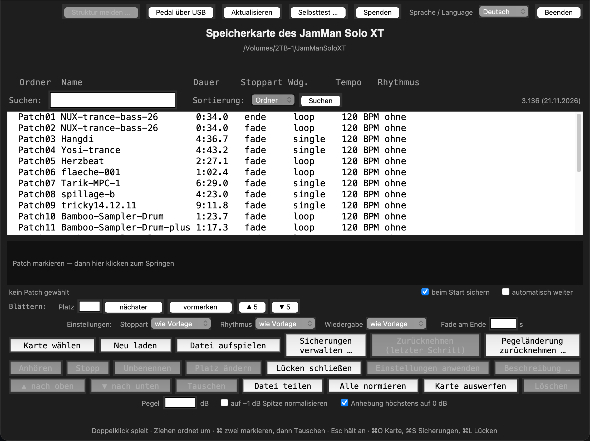

# jamman-card-tool — deutsche Anleitung

Für Speicherkarte und internen Speicher — auch über USB.

Die Speicherkarte des **DigiTech JamMan Solo XT, Stereo und Delay** von macOS,
Windows oder Linux aus verwalten — ohne JamManager XT.

*English version: [README.md](README.md) · Seite mit Bildern:
https://www.julius-k.de/tool/*

Karten des **JamMan Stereo** und **JamMan Delay** werden über ihre
Geräteordner `JamManStereo` und `JamManDelay` erkannt. Der Solo XT bleibt
das Standardgerät; beim Delay wird derselbe Kartenaufbau angenommen. Die
Stereo-Unterstützung wurde mit einer nachgebauten Karte geprüft und seit
13.11.2026 **von einem Nutzer an einem echten JamMan Stereo (Kubuntu)
bestätigt** ("Funktioniert, top.") — trotzdem vor dem ersten Schreiben die
Karte kopieren.

**Hintergrund:** Das offizielle Programm *JamManager XT* (Version 2.0 von
2012) stürzt auf aktuellen macOS-Versionen ab, sobald das Pedal erkannt
wird (`Tcl_Panic` in `TkpInit`), und wird nicht mehr gepflegt. Dieses
Werkzeug arbeitet **direkt auf der Speicherkarte**. Dafür muß die microSD
aus dem Pedal heraus und in einen Kartenleser oder Kartenslot — über das
USB-Kabel meldet sich das Pedal unter aktuellen macOS-Versionen nicht als
Laufwerk. Kein Windows, kein Rosetta, kein Emulator.

Reines Python 3 mit der Standardbibliothek. Kein ffmpeg, kein Homebrew.

---



**Selbst prüfen:** Wenn ein Knopf nichts tut oder ein Fenster offen bleibt,
kannst du das Werkzeug selbst testen. Es baut eine Testkarte im
Temp-Ordner, drückt jeden Knopf und spielt die Dateibefehle durch — ohne
Pedal, ohne Internet:

```
JamMan-macOS.command funktionstest         # macOS
JamMan-Windows.bat funktionstest           # Windows
./JamMan-Linux.sh funktionstest            # Linux
```

Mit `--alle-sprachen` läuft es in allen fünf Sprachen. Am Ende steht
„keine Befunde" oder eine Liste; die Meldungen landen zusätzlich in
`jamman-fehler.log` und lassen sich mitschicken.


## Neue Fassungen

Beim Öffnen des Fensters fragt das Werkzeug **einmal am Tag** bei GitHub nach
der neuesten Fassung. Ist sie neuer als die laufende, erscheint ein Hinweis mit
dem Angebot, die Download-Seite zu öffnen. Die Abfrage läuft im Hintergrund —
ohne Netz öffnet sich das Fenster genauso schnell, und es wird nichts gemeldet.

Übertragen wird dabei nur die Anfrage an `api.github.com`: keine Karte, keine
Dateinamen, kein Benutzername.

Abschalten: in der Einstellungsdatei (Pfad zeigt `jamman.py selbsttest`) die
Zeile

```
update_pruefung=nein
```

eintragen.

## Was es kann

| Befehl | Wirkung |
|---|---|
| `liste` | Patches auflisten: Name, Dauer, WAV-Format |
| `abspielen --patch N` | einen Patch anhören |
| `aufspielen --wav DATEI` | Datei als neuen Patch anlegen (wandelt auf 44,1 kHz / 16 Bit / Stereo) |
| `aendern --patch N` | Stopp-Verhalten, Loop/Single, Rhythmus oder Namen ändern |
| `verschieben --patch N --nach M` | Patch an eine andere Stelle schieben |
| `loeschen --patch N` | Patch entfernen (vorher Sicherung) |
| `sichern --ziel ORDNER` | die ganze Karte auf den Rechner kopieren |
| `saeubern` | macOS-Dateien (`._*`, `.DS_Store`) von der Karte entfernen |
| `auswerfen` | Karte abmelden |
| `gui` | kleines Fenster (tkinter) |
| `menu` | Textmenü — braucht kein tkinter |

**Ohne `--schreiben` wird nichts verändert** (Trockenlauf).
**Vor jedem Schreibvorgang** werden die betroffenen Patches nach
`~/JamMan-Sicherung` gesichert.

---

## Über USB

Das Pedal erscheint nicht als Laufwerk. Es spricht ein serielles Protokoll
(„Greenglass", CDC-ACM), und das Werkzeug redet direkt damit — kein Treiber,
kein JamManager. Der Knopf **„Pedal über USB"** öffnet ein Fenster für den
**internen Speicher** und die **SD-Karte** des Pedals:

* Patches mit Namen auflisten, zwischen internem Speicher und Karte wechseln
* alles ins Hauptfenster holen (erst die Beschreibungen, dann die Töne)
* einen ganzen Patch-Ordner aufs Pedal schreiben, Platz für Platz
* einen ganzen **geholten Ordner auf einmal** zurückschreiben
  („Schreiben ▾ → Ganzen Ordner aufs Pedal …") — belegte Plätze werden
  gesichert, unveränderte übersprungen
* einen **Platz löschen** („Schreiben ▾ → Platz löschen …")
* eine Audiodatei als neuen Patch schreiben (jedes Format, umgewandelt auf
  44,1 kHz / 16 Bit / Stereo)
* **rückwärts** abspielen (das Pedal dreht den Loop; das Fenster hört ihn
  zum Prüfen ebenfalls rückwärts, sofern ffmpeg vorhanden ist)
* das **Tempo** je Patch sehen und setzen (Spalte Tempo, „Beschreibung …“)
* alles als ZIP sichern, alte Sicherungen aufräumen
* Setlists sichern und wieder holen
* **JamLists aus JamManager XT** lesen und eigene Setlists als JamList ablegen
  (die Bibliothek des Herstellers ist eine SQLite-Datei, kein Sonderformat)
* **suchen und sortieren** in der Liste (Ordner, Name, Dauer, Länge)
* **rückwärts** abspielen und das **Tempo** je Patch sehen und setzen
* einen **Platz löschen** und **Lücken schließen** (Plätze aufrücken)
* ein **Speicherabbild** des Pedals aufnehmen und zwei vergleichen (nur lesend)
* den letzten Schreibvorgang rückgängig machen

Was überschrieben wird, liegt vorher auf dem Rechner — je Platz bleiben die
letzten fünf Sicherungen (`vor-ueberschreiben/<Platz>/<Zeitstempel>`).
Dateien über 10 Minuten lehnt das Werkzeug ab; das Pedal nimmt sie nicht an.
Über USB fließen etwa
1,3 MB/s — ein Acht-Minuten-Loop braucht rund eine Minute. Steckt die Karte
in einem Leser, nimm den Leser: er ist um ein Vielfaches schneller.

**Aktualisieren:** Der Knopf „Aktualisieren“ im Fenster holt die neueste Fassung von GitHub, prüft sie und ersetzt die Programmdateien. Die alten Dateien wandern vorher nach `sicherung-vor-<alte Fassung>/`; die Einstellungen in `~/.jamman-werkzeug.cnf` bleiben unberührt. Auf der Kommandozeile: `jamman.py aktualisieren`.


**Automatisch:** Das Werkzeug sieht einmal am Tag bei GitHub nach und installiert eine neuere Fassung selbst. Abschalten mit dem Häkchen „Update beim Start" — dann fragt es wie früher nach.
Unter Windows braucht USB zusätzlich `pyserial` (`pip install pyserial`);
macOS und Linux brauchen nichts weiter. Unter Ubuntu ist der Zugriff auf
den internen Speicher über USB am 17.11.2026 bestätigt.

**Linux: Gruppe `dialout` — und danach wirklich neu starten.** Fehlt der
Zugriff, gehört der Benutzer nicht zur Gruppe `dialout`:
`sudo usermod -aG dialout $USER`. Nach dem Befehl reicht Ab- und Anmelden
nicht immer — ein Nutzer unter Kubuntu hat es am 18.11.2026 erst nach einem
**Neustart** zum Laufen gebracht. Wer `groups` aufruft und `dialout` dort
nicht sieht, ist noch in der alten Sitzung.

Windows 10 erkennt das Pedal als „USB-Seriell-Gerät (COMx)" — am 17.11.2026
bestätigt. Gelesen und geschrieben wurde unter Windows noch nicht geprüft.

## Starten

Im Paket liegen nur wenige Dinge offen: die drei Starter (je Betriebssystem
einer), diese Anleitung, die Lizenz und zwei Ordner.

`Hilfe-Help-Aide-Ayuda-帮助/` trägt seinen Namen in allen Sprachen, die das
Werkzeug spricht — wer nur Chinesisch oder Spanisch liest, erkennt ihn trotzdem.
Darin liegen die Zusatzstarter (Konsolenfenster, Textmenü), die alten kurzen
Dateinamen als Weiterleitung und die Textdateien.

`.jamman/` ist absichtlich versteckt: dort liegt das Programm selbst. Man muß
nicht hineinsehen.

**macOS:** `JamMan-macOS.command` doppelklicken. Es öffnet sich ein Terminal (das
macht macOS bei `.command`-Dateien so), und nach dem Schließen des Werkzeugs
**schließt sich das Fenster mit**. Beim ersten Mal fragt macOS, ob das Skript
„Terminal" steuern darf — einmal **Erlauben**, danach ist Ruhe.

Wer das nicht erlauben will, drückt „Nicht erlauben"; dann bleibt das Fenster
wie bisher stehen, und derselbe Effekt läßt sich ohne Rückfrage einstellen:
Terminal → Einstellungen → Profile → „Shell" → „Wenn die Shell beendet wird:
Fenster schließen".

**Mit iTerm** schließt das Skript nichts (iTerm läßt sich nicht ohne Rückfrage
steuern); dort macht es die Einstellung: iTerm → Settings → Profiles →
General → „When the session ends: Close" — beim Profil „Default" ist das ab
Werk eingeschaltet, dann geht das Fenster von selbst.

**Windows:** `JamMan-Windows.bat` doppelklicken (ohne Konsolenfenster) oder
`JamMan-Windows-Konsole.bat`, wenn Meldungen sichtbar bleiben sollen.

**Linux:** `./JamMan-Linux.sh`.

## Firmware von einem Pedal auf das andere

Das Pedal hat keinen Firmware-Server mehr: die Adresse, von der JamManager XT
früher aktualisiert hat (`digitech.com/updater/…`), ist abgeschaltet. Wer zwei
Pedale mit unterschiedlicher Firmware hat, kann den neueren Stand auf das
ältere übertragen — das Werkzeug kann es.

**Was Firmware hier ist.** Kein geheimnisvolles Paket, sondern Dateien auf
einem QNX-System im Pedal:

```
/mnt/nandfs/usr/IOMgr        E/A-Verwalter
/mnt/nandfs/usr/JamManUI     Bedienoberfläche
/mnt/nandfs/usr/loopengine   Loop-Engine
/mnt/nandfs/usr/usbserial    USB-Seriell-Treiber
/mnt/nandfs/usr/attributes/  Tastenbelegung und Warteschlange (nur neuere Fassungen)
/mnt/nandfs/lib/             devb-sd-at91sam9g35 · devc-serusart
                             devc-serusb_g · devu-g15-at91sam_g.so
```

**Ablauf.**

```
1  Am NEUEREN Pedal:  „Sichern ▾ → Firmware dieses Pedals holen …"
   → Ordner wählen; die acht Dateien landen darunter (…/mnt/nandfs/…)
2  Am ÄLTEREN Pedal:  „Schreiben ▾ → Firmware übernehmen …"
   → denselben Ordner wählen
3  Vorher sichert das Werkzeug ALLE Dateien des Zielgeräts nach
   sicherung-vor-firmware-<Zeitstempel>/
4  Danach schreibt es die Dateien — und prüft nach jeder die Größe
5  Pedal aus- und wieder einschalten; die Fassung steht beim Start im Display
```

**Was dabei bewußt nicht passiert:**

```
unit_guid.attr        bleibt beim Zielgerät — das ist die Kennung DIESES Pedals
JamManSoloXT.xml      bleibt unangetastet — darin stehen deine Einstellungen
.filetable            wird nicht kopiert — der Verzeichnisindex gehört dem Pedal
```

**Warum „einmal daneben schreiben":** QNX läßt eine Datei nicht überschreiben,
solange sie läuft („Resource busy"). Das Werkzeug schreibt deshalb erst
`…/JamManUI.neu` und benennt sie dann über die alte.

**Das Risiko, ohne Beschönigung.** Ein Abbruch mittendrin kann das Pedal
unbrauchbar machen; es gibt keinen Weg zurück außer der Sicherung auf dem
Rechner. Am 18.11.2026 wurde ein Solo XT von FirmwareVersion 5376 auf 5632
gebracht (Anzeige danach „1.06") — es hat funktioniert, aber es bleibt ein
Eingriff in Systemdateien.

## macOS: „JamMan-macOS.command" wurde nicht geöffnet

Lädt man das ZIP aus dem Netz, hängt macOS jedem entpackten Programm eine
Markierung an (Quarantäne). Beim ersten Start erscheint dann:

> „JamMan-macOS.command" nicht geöffnet — Apple konnte nicht überprüfen, ob
> „JamMan-macOS.command" frei von Schadsoftware ist.

Das ist kein Fehler des Werkzeugs, sondern die Voreinstellung für alles, was
nicht bei Apple angemeldet ist. Zwei Wege:

**Einmal erlauben:** im Finder mit der rechten Maustaste (oder Ctrl-Klick) auf
`JamMan-macOS.command` → **Öffnen** → im Dialog noch einmal **Öffnen**. Danach startet
es dauerhaft per Doppelklick.

**Oder die Markierung entfernen** (im Terminal, Pfad anpassen):

```
xattr -dr com.apple.quarantine /Pfad/zum/Ordner/jamman-card-tool
```

## Aufbau der Karte

An echter Hardware geprüft (26.10.2026):

```
JamManSoloXT/
    Patch01/
        patch.xml          <PatchName>, <RhythmType>, <StopMode>, <ID>
        PhraseA/
            phrase.wav     44,1 kHz, 16 Bit, Stereo, PCM
            phrase.xml     <IsLoop> (Single/Loop), Tempo, <ID>
    Patch02/
    ...
```

Der Platz ergibt sich aus dem Ordnernamen: `Patch07` erscheint im Pedal
als Patch 7. **Die Namen gehören dem Gerät** — das Werkzeug erfindet keine
neuen.

Auf der Karte gibt es zwei Stopp-Arten: `FadeOut` und `StopInstantly`,
und zwei Rhythmen: `Silence` und `StudioKickAndHighHat` (letzterer
gehört zu `<SettingsVersion>1</SettingsVersion>`).

---

## Herunterladen

```
git clone https://github.com/Suilui1/jamman-card-tool.git
```

Oder auf der Projektseite "Code" → "Download ZIP".

## Voraussetzungen

* **Python 3** mit tkinter — tkinter nur für das Fenster; `menu` braucht es nicht

| System | Python | Start |
|---|---|---|
| macOS | `xcode-select --install` oder Python von [python.org](https://www.python.org/downloads/) | `JamMan-macOS.command` |
| Windows | Python von [python.org](https://www.python.org/downloads/) („Add python.exe to PATH") | `JamMan-Windows.bat` |
| Linux | `sudo apt install python3-tk` | `./JamMan-Linux.sh` |

Für den Ton nimmt es, was da ist: `afplay` (macOS), `winsound` (Windows),
`aplay`/`paplay`/`mpv`/`ffplay` (Linux).

**MP3 und M4A unter Windows:** Das Pedal nimmt nur WAV. Zum Umwandeln
braucht Windows `ffmpeg`:

```
winget install --id Gyan.FFmpeg
```

oder `ffmpeg.exe` einfach neben `jamman.py` legen. Mit WAV-Dateien geht es
auch ohne ffmpeg.

**Karte finden:** Das Werkzeug sucht selbst — macOS `/Volumes/*`,
Windows alle Laufwerksbuchstaben, Linux `/media/<benutzer>/*`,
`/run/media/<benutzer>/*`, `/mnt/*`.

**Was geprüft ist und was nicht:**

| System | Stand |
|---|---|
| macOS (Apple Silicon) | vollständig geprüft, täglich im Einsatz |
| macOS (Intel) | gleicher Code, gleiche Python-Version — erwartet, **nicht** geprüft |
| Windows | Ton über `winsound`, Kartenfindung über Laufwerke — **nicht** auf einem Windows-Rechner geprüft |
| Linux | Ton über `aplay`/`paplay`, Kartenfindung über `/media` — **nicht** auf einem Linux-Rechner geprüft |
| Android | **geht nicht**: Tkinter gibt es dort nicht, und Android kann die Karte nicht beschreibend einbinden. Das wäre eine neue App, keine Portierung. |

Wenn etwas fehlt, sagt es `jamman.py selbsttest`: System, Tonprogramm,
Kartenwurzeln und Schrift stehen dann in der Ausgabe.

---

## Befehlsnamen

Jeder Befehl existiert auf Deutsch und auf Englisch:

| Aufgabe | Befehle |
|---|---|
| Patches auflisten | `liste` · `list` |
| Karte sichern | `sichern` · `backup` |
| Datei aufspielen | `aufspielen` · `import` |
| Patch anhören | `abspielen` · `play` |
| Patch löschen | `loeschen` · `delete` |
| verschieben / tauschen / platzieren | `verschieben` · `move`, `tauschen` · `swap`, `platzieren` · `place` |
| aus Sicherung zurückholen | `zuruecknehmen` · `restore` |
| alle normieren | `alle-normieren` · `normalize` |
| Pegel zurücknehmen | `pegel-umkehren` · `undo-level` |
| Datei teilen | `teilen` · `split` |
| Patch ändern | `aendern` · `change` |
| aufräumen | `saeubern` · `clean` |
| Karte auswerfen | `auswerfen` · `eject` |
| Ordnernamen angleichen | `namensform` · `names` |
| Fenster / Textmenü | `gui` · `menu` |
| Selbsttest | `selbsttest` · `selftest` |

`--help` folgt der gewählten Sprache.

## Benutzung

```bash
# Karte eingelegt: /Volumes/JAMMAN oder D:\ oder /media/<benutzer>/JAMMAN
python3 jamman.py liste

# zuerst die ganze Karte sichern — immer eine gute Idee
python3 jamman.py sichern --ziel ~/JamMan-Sicherung --schreiben

# Datei als neuen Patch anlegen
python3 jamman.py aufspielen --wav meinloop.wav --name "Mein Loop" \
        --stopp fade --wiedergabe loop --schreiben

# vorhandenen Patch ändern
python3 jamman.py aendern --patch 7 --stopp fade --wiedergabe loop --schreiben

# verschieben / löschen
python3 jamman.py verschieben --patch 12 --nach 3 --schreiben
python3 jamman.py loeschen --patch 12 --schreiben

# fertig
python3 jamman.py auswerfen
```

Die Karte wird selbst gefunden. Mit `--karte /pfad/zur/karte` lässt sich
ein Pfad vorgeben.

---

## Das 10-Minuten-Limit umgehen: Datei teilen

**Das Pedal nimmt höchstens 10 Minuten pro Loop an** (Handbuch Seite 60,
stereo). Längere Dateien landen zwar auf der Karte, erscheinen am Pedal
aber nicht — sie können sogar wieder verschwinden.

Das Handbuch liegt hier: <https://eadn-wc05-7545739.nxedge.io/wp-content/uploads/2022/09/DigiTech_JamMan_Solo_XT_Manual.pdf>
(9 MB, DigiTech). Dieselbe Quelle nennt die übrigen Grenzen: 44,1 kHz,
16 Bit, Stereo, höchstens 200 Loops, microSDHC bis 32 GB.

Das Werkzeug lehnt eine zu lange Datei deshalb ab und bietet drei Wege an:

| Weg | Aufruf | Ergebnis |
|---|---|---|
| kürzen | `--kuerzen` | eine Datei, auf 9:59 beschnitten (die letzten 12 ms ausgeblendet) |
| auf Länge schneiden | `--laenge 540` | eine Datei mit höchstens 540 s |
| **teilen** | `--teile 2` | **zwei Patches, jeder unter dem Limit** |

### Wie das Teilen arbeitet

```
python3 jamman.py split --wav aufnahme.wav --name "Stück" --teile 2
python3 jamman.py split --wav aufnahme.wav --name "Stück" --laenge 540
```

- `--teile N` teilt in N etwa gleich lange Stücke, `--laenge S` in Stücke
  von höchstens S Sekunden.
- Geschnitten wird **an Pausen**, wenn es welche gibt (±90 s um den
  rechnerischen Punkt). `--einfach` schneidet stattdessen gleichmäßig.
- Die Naht ist **sample-genau**: es geht kein Sample verloren, keines wird
  doppelt.
- Die Pause an der Naht wird **herausgenommen**, damit Teil 1 dort endet,
  wo der Ton aufhört, und Teil 2 dort beginnt, wo er wieder einsetzt.
  Mit `--mit-pause` bleibt sie stehen.
- Die Teile heißen `Stück 1/2`, `Stück 2/2` … und belegen die nächsten
  freien Plätze. **Jeder Teil muss für sich unter 10 Minuten bleiben** —
  das prüft das Werkzeug und kürzt notfalls.

Im Fenster ist es der Knopf **„Datei teilen"** mit dem Feld „Teile" und dem
Kästchen „an Pausen schneiden".

### Am Pedal zusammenspielen

Die Teile sind eigenständige Patches. Für den nahtlosen Übergang schaltet
das Pedal mit dem **FS3X-Fußschalter** weiter: den nächsten Loop **mindestens
2 Sekunden vor dem Ende** vorwählen (Handbuch Seite 57), dann schließt er
lückenlos an. Ohne FS3X geht es mit UP/DOWN von Hand — dann entsteht eine
kurze Pause.

Das Werkzeug macht dasselbe zum Prüfen: Kästchen „automatisch weiter" oder
Knopf „vormerken" spielt die Teile ohne Lücke hintereinander (Fassung 3.27
und später).

## Stand

| System | Stand |
|---|---|
| macOS 27, Apple Silicon | getestet, alle Funktionen |
| macOS 15, Intel (MacBook Pro 2012) | getestet, alle Funktionen |
| Windows 10 | vom Verfasser getestet (Fenster und Kommandozeile) |
| Linux (Ubuntu Studio) | vom Verfasser getestet |
| Linux (Kubuntu) | von einem Nutzer bestätigt, **JamMan Stereo** |

„Getestet" heißt: Fenster geöffnet, Karte gelesen, ein Patch geschrieben und
am Pedal zurückgelesen. Für den **Stereo** gibt es bisher eine Rückmeldung —
von dem Nutzer unter Kubuntu. Unter Windows hat noch niemand eine
Stereo-Karte gemeldet.

Auf manchen Intel-Macs bringt Apples Python 3.9 das alte Tk 8.5.9 mit, das
beim Öffnen eines Fensters abstürzt. `JamMan-macOS.command` erkennt das und
weicht auf das Textmenü aus; Python von python.org (Tk 8.6) bringt das
Fenster zurück.

---

## Sicherheit

Dieses Werkzeug schreibt auf eine Speicherkarte, von der ein Gerät lebt.

* Es sichert vor jedem Schreibvorgang — **trotzdem vor dem ersten
  Schreiben eine eigene Kopie** des Ordners `JamManSoloXT` ziehen.
* Nach jeder Änderung: Karte auswerfen, ins Pedal stecken, nachsehen.
  Was das Gerät wirklich macht, steht in keiner XML-Datei.
* Erst an einem Patch testen, dann an der ganzen Karte.
* Keine Gewährleistung. Siehe `LICENSE`.

Keine Verbindung zu DigiTech, Harman oder Samsung. Die Namen dienen nur
der Beschreibung, wofür das Werkzeug gedacht ist.

---

## Sprachen

Das Werkzeug spricht Deutsch, Englisch, Französisch, Spanisch und
Chinesisch. Drei Wege führen zur Sprache:

| Weg | Geltung |
|---|---|
| im Fenster: „Sprache / Language" oben rechts | dauerhaft (gespeichert in `~/.jamman-werkzeug.cnf`) |
| `--sprache en` auf der Kommandozeile | für diesen Lauf |
| ohne Angabe | Systemsprache aus `LANG`/`LC_ALL`, sonst Deutsch |

**Zum Stand der Übersetzungen:** Deutsch ist die Ausgangssprache,
Englisch ist vollständig und geprüft. Französisch, Spanisch und Chinesisch
sind übersetzt, aber **nicht von Muttersprachlern gegengelesen** — im
Fenster steht bei diesen Sprachen deshalb ein Hinweis. Korrekturen sind
willkommen: die Texte stehen als Wörterbuch oben in `jamman.py`
(`TEXTE`, Schlüssel ist der deutsche Satz).

Fehlt eine Übersetzung, erscheint der englische Text, sonst der deutsche.
Eine halbfertige Übersetzung führt also nie zu leeren Beschriftungen.

## Unterstützen

Das Werkzeug ist kostenlos. Wer es nützlich findet, darf gern etwas
beitragen:

**Spenden:** [paypal.com/donate … PEJEFMSKUPA8C](https://www.paypal.com/donate/?hosted_button_id=PEJEFMSKUPA8C&currency_code=EUR)

Der Knopf „Spenden" im Fenster öffnet dieselbe Seite. Die Kennung ist
öffentlich; Kontodaten stehen nicht darin.

## Lizenz

MIT — siehe [LICENSE](LICENSE).
Englische Anleitung: [README.md](README.md).
